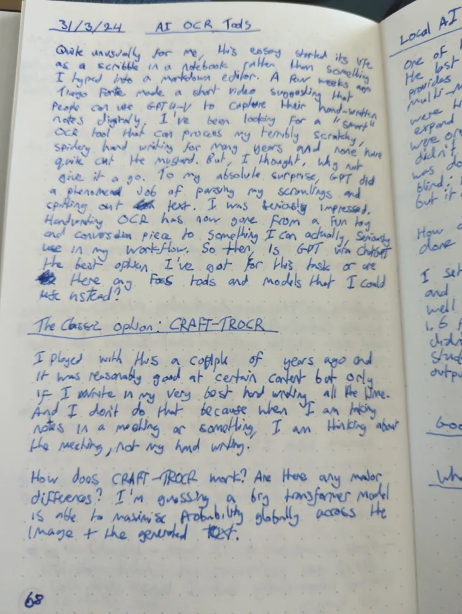

# note-digitizer

Photo of handwritten notes in, Markdown and a rendered Mermaid diagram out.

A tiny demo of the [Claude Agent SDK](https://docs.claude.com/en/docs/claude-code/sdk): a [Hono](https://hono.dev) server runs the agent, one static `public/index.html` is the whole UI. No framework, no build step, no database, no auth.



*Sample input (see [Credits](#credits)). Output: the page transcribed as Markdown with spelling fixed from context, headings kept, and any diagram on the page as a Mermaid block.*

## What it does

- Upload a photo from a phone or laptop, watch the agent's progress stream live.
- Gets back Markdown, plus the diagram as a Mermaid block that is rendered in the page.
- Copy buttons for the Markdown and the Mermaid code.
- Rejects images that are not handwriting (printed text, screenshots, people, scenery).
- Fixes spelling and grammar from context, since handwriting produces slips. Truly unreadable words are marked `[?word?]`.
- Shows run stats: wall and API time, input/output/cache tokens, API-equivalent cost, per-model split.

## Requirements

- Node.js 20+
- [Claude Code](https://docs.claude.com/en/docs/claude-code) installed and logged in (`claude auth login`). The SDK spawns the official `claude` binary and uses its login.
- macOS is optional: `sips` normalizes HEIC and huge photos to a 1600px JPEG. Without it, JPEG, PNG, GIF and WebP are sent as they are.

## Run

```bash
npm install
npm start
```

It prints a `Local:` URL and a `Phone:` URL. Open the second one from a phone on the same wifi. Set `PORT` to change the port (default 3000).

## How it works

```
browser --multipart--> POST /digitize --> digitize() --> Agent SDK query() --> claude binary
   ^                                          |
   '------------- Server-Sent Events <--------'   init, thinking..., result | rejected | error
```

- **Image inline.** The photo is sent as an image block in the user message. Reading it through the agent's `Read` tool cost 60-80k cache tokens (~$0.33) per run versus ~2k (~$0.01) inline, and needed an extra turn.
- **Typed output.** A [zod](https://zod.dev) schema (`DigitizeOutput`: `is_handwritten`, `reason`, `markdown`) is converted to JSON Schema and passed as `outputFormat`, then validated again with `safeParse`. Use `target: "draft-7"`: the CLI rejects the `$schema` that zod emits by default.
- **No tools, auto mode.** `tools: []`, `permissionMode: "auto"`, `settingSources: []` so no user `CLAUDE.md`, skills or memory leak into the call.

## Cost

About $0.01-0.02 per photo at API list prices (see the stats panel). On a Claude plan login nothing is billed per token, the run counts against your plan limits.

## Tests

```bash
npm test        # 15 deterministic tests, SDK faked, no network, under a second
npm run eval    # live evals on the real model, ~10 s, uses your Claude login
```

`npm run eval` checks: printed text is rejected, hard words in the handwritten sample come out spelled correctly, no invented diagram, and cost stays under $0.10 (a regression to the `Read` tool path would show up here). A failing eval is a blocker.

## Security and terms

- The server listens on `0.0.0.0` and has **no authentication**. Anyone on your network can spend your quota. Use it on a trusted network, or put your own auth in front. One request runs at a time.
- By default the child process gets no `ANTHROPIC_API_KEY`, so your own Claude login is used. Anthropic's terms ask for API-key authentication when a product serves other people. If you do that, run with `NOTE_DIGITIZER_USE_API_KEY=1` and your `ANTHROPIC_API_KEY`.
- Uploaded photos live only in memory and in a temp directory that is deleted after each request.

## Credits

The sample image in `tests/fixtures/handwriting-sample.webp` is a photo of a handwritten page from [brainsteam.co.uk](https://brainsteam.co.uk). It belongs to its author and is used here only as a test input. Open an issue and it will be replaced.

## License

[MIT](LICENSE)
